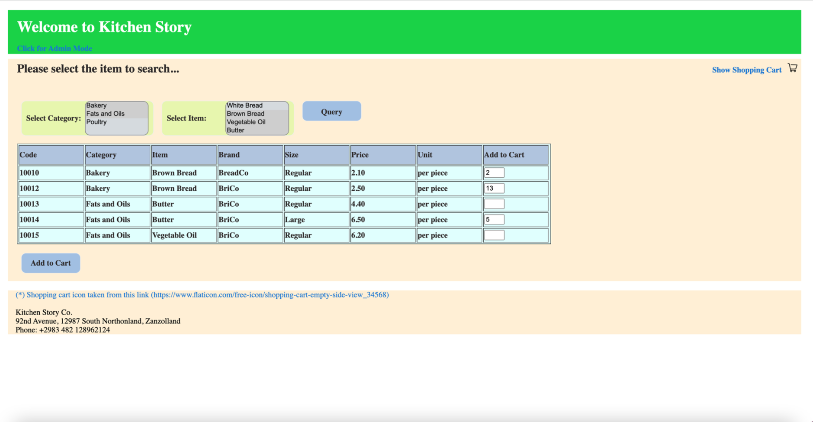
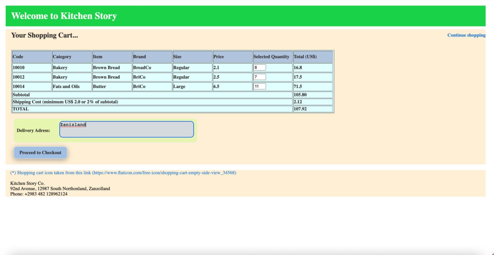
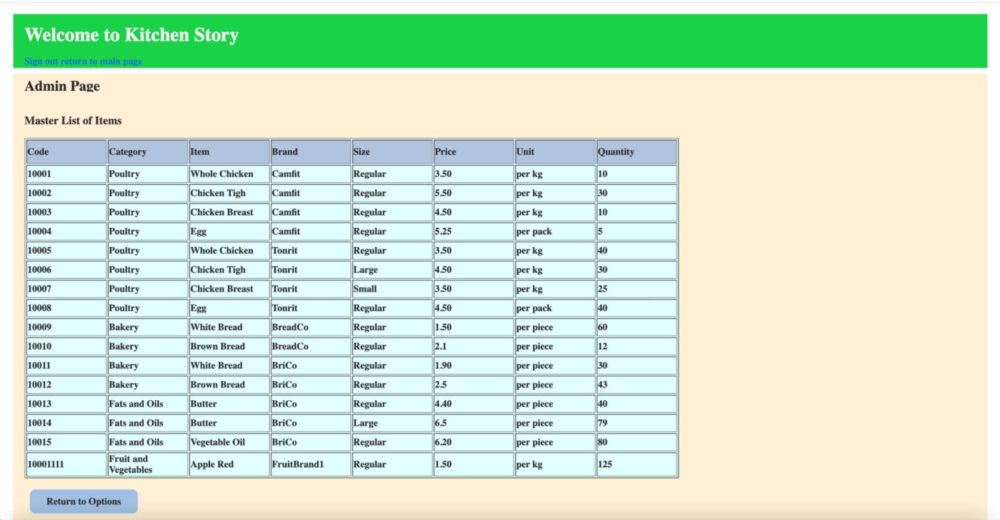

# Kitchen Story – Full-Stack E-Commerce Application

Kitchen Story is a full-stack e-commerce web application developed as an academic project in 2021. The application provides a customer-facing grocery shopping workflow together with an administrative interface for product and inventory management.

The project demonstrates end-to-end web application development using an **Angular frontend**, **Java/Spring Boot REST backend**, and **MongoDB database**.

## Technologies

### Frontend
- Angular 12
- TypeScript
- HTML
- CSS
- Angular Router
- Angular HttpClient

### Backend
- Java 8
- Spring Boot 2.5
- Spring Web
- Spring Data MongoDB
- Maven

### Database
- MongoDB

## Architecture

```text
             Customer / Administrator
                       │
                       ▼
                Angular Frontend
             Components & Services
                       │
                  HTTP / REST
                       │
                       ▼
              Spring Boot Backend
                REST Controllers
                       │
                       ▼
                    MongoDB
              Products / Users
```

The Angular application provides the user interface and communicates with the Spring Boot backend through HTTP requests. The backend exposes REST endpoints for product, inventory, and administrator operations, with MongoDB providing data persistence.

## Customer Features

Customers can:

- Search products by category and item
- View available products, brands, sizes, prices, and quantities
- Select product quantities
- Add products to a shopping cart
- Review order details and totals
- Enter delivery information
- Complete the simulated payment workflow
- Receive an order confirmation
- Update inventory quantities following a purchase

## Administrator Features

The administrative interface supports:

- Administrator login
- Password management
- Product master-list viewing
- Product lookup by item code
- Adding products
- Updating products
- Deleting products
- Inventory quantity management

## Application Screenshots

### Product Search and Selection

Customers can search the product catalog by category and item and select quantities for purchase.



### Shopping Cart

Selected products are transferred to the shopping cart, where quantities, individual amounts, shipping cost, and the total order amount are displayed.



### Administrator Inventory Management

The administrator interface provides product lookup and add, update, and delete operations for managing the product catalog and inventory.



## Frontend Structure

The Angular frontend separates the major application workflows into components:

```text
kitchenstoryapp/
└── src/
    └── app/
        ├── maincomp/       # Product search and selection
        ├── cartcomp/       # Shopping cart
        ├── paycomp/        # Payment and order workflow
        ├── admincomp/      # Administration
        └── services        # Backend communication and cart state
```

Angular services use `HttpClient` to communicate with the Spring Boot backend.

## Backend Structure

The Java/Spring Boot backend separates REST controllers, database entities, and repositories:

```text
KitchenStoryBackEndMongoDB/
└── src/
    └── main/
        ├── java/
        │   └── com/example/kitchenstorybackendmongodb/
        │       ├── controller/
        │       ├── entity/
        │       └── repository/
        └── resources/
            └── application.properties
```

Spring Data repositories provide access to MongoDB, while REST controllers expose the application functionality to the Angular frontend.

## REST API Functionality

The backend provides endpoints for operations including:

- Retrieving the complete product catalog
- Searching products by item
- Retrieving individual products by code
- Retrieving product categories and category items
- Adding and updating products
- Deleting products
- Administrator authentication
- Administrator password management

## Product Data

Product records contain information including:

- Product code
- Category
- Item
- Brand
- Size
- Price
- Unit
- Available quantity

## Customer Purchase Workflow

```text
Product Search
      │
      ▼
Product Selection
      │
      ▼
Shopping Cart
      │
      ▼
Delivery Information
      │
      ▼
Payment
      │
      ▼
Order Confirmation
      │
      ▼
Inventory Update
```

## Running the Project

This is an archived 2021 academic project. The original application was designed to run locally with:

- Angular frontend on `localhost:4200`
- Spring Boot backend on `localhost:8370`
- MongoDB database

### Backend

From the `KitchenStoryBackEndMongoDB` directory:

```bash
./mvnw spring-boot:run
```

### Frontend

From the `kitchenstoryapp` directory:

```bash
npm install
npm start
```

Because this project was developed in 2021, some dependencies or local configuration may need to be updated to run in a current development environment.

## Demo Administrator

The original academic application initializes a demonstration administrator account for testing the administrative workflow.

These credentials are sample application data only and are not intended for use in a production environment.

## Academic Context

This project was developed in October 2021 as part of a **Full-Stack Java Developer** program.

The project was designed to demonstrate:

- Frontend development with Angular
- Backend development with Java and Spring Boot
- REST-based frontend/backend communication
- MongoDB data persistence
- E-commerce workflows
- Administrative authentication
- CRUD operations
- Inventory management

This repository is retained as an example of early full-stack software engineering work.

## Author

**Serkan Bayramoglu**

## Note

This is an archived academic project and is maintained primarily as a portfolio example. The authentication and payment functionality are demonstrations and should not be considered production-ready implementations.
